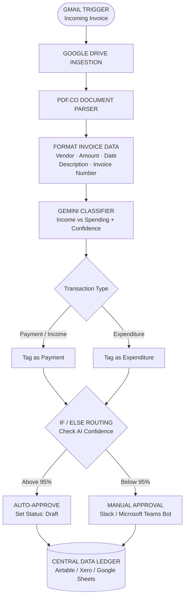

# Business Accountant AI Automation Workflow

An n8n-based invoice-processing workflow designed to receive invoice emails, extract financial details, classify transactions as payment/income or expenditure, and route them for automated or manual review.

**Author:** Okolo Onochie

## Project overview

The workflow is intended to reduce repetitive invoice-processing and bookkeeping tasks through email intake, document handling, invoice data extraction, AI-assisted classification, confidence-based routing, and a central financial record destination.

## System organogram

This diagram follows the workflow structure from the n8n screenshots and earlier build discussion.

## Workflow sequence

1. **Gmail Trigger:** receives an incoming invoice email.
2. **Google Drive Ingestion:** stores or retrieves the invoice document.
3. **PDF.co Document Parser:** processes the invoice PDF and extracts its contents.
4. **Format Invoice Data:** prepares Vendor, Amount, Date, Description, and Invoice Number.
5. **Gemini Classifier:** classifies the transaction as payment/income or expenditure and returns a confidence value.
6. **Transaction tagging:** applies the Payment or Expenditure tag.
7. **IF / ELSE Routing:** checks AI confidence against the 95% threshold.
8. **Auto-Approve:** the high-confidence path sets the status to Draft.
9. **Manual Approval:** the lower-confidence path is intended for review through a Slack or Microsoft Teams bot.
10. **Central Data Ledger:** records the processed result in the configured destination.

## Technology stack

- n8n — workflow orchestration
- Gmail — invoice email intake
- Google Drive — invoice document storage/retrieval
- PDF.co — PDF upload and invoice parsing
- Google Gemini — transaction classification
- Slack or Microsoft Teams — manual approval route
- Airtable, Xero, or Google Sheets — central ledger destination (confirm the active destination in the current workflow)

## Repository structure

- `workflows/01-invoice-processing/` — workflow notes, JSON export location, and screenshots.
- `documentation/` — project overview, architecture, setup, testing, and limitations.
- `diagrams/` — system organogram.

## Known PDF.co integration detail

During the earlier build, the incoming invoice was available as binary data, while the PDF.co AI Invoice Parser expected a PDF URL or file token. The PDF.co Upload File step was discussed to upload the binary and obtain a usable file reference for parsing. A Gateway-credit warning was also encountered, so the user's own PDF.co credentials and available credits need to be checked.

## Current documentation status

This repository structure and diagram are based on the previously shared workflow screenshots and build discussion. The current n8n JSON export has not yet been reviewed here. Exact node parameters, Gemini prompt, parser schema, final ledger destination, and successful end-to-end execution are therefore not claimed as verified.

## Responsible use and security

- Treat AI classification as decision support, not a substitute for financial controls.
- Keep human review for uncertain or material transactions.
- Test with synthetic invoices before processing real financial records.
- Never commit API keys, OAuth tokens, webhook secrets, real invoices, or personal/financial information.
