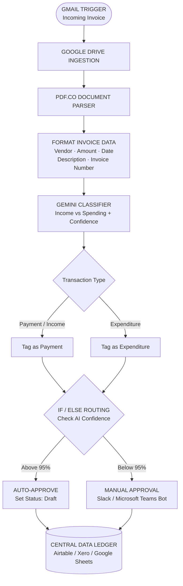

# Business Accountant AI Automation — System Organogram

## Notes
- The 95% threshold and Draft status are taken from the earlier workflow discussion.
- The central ledger options were described as Airtable, Xero, or Google Sheets; confirm which one is actually connected in the current n8n workflow.
- Verify exact node connections and execution status against the current workflow export before treating the diagram as final.
